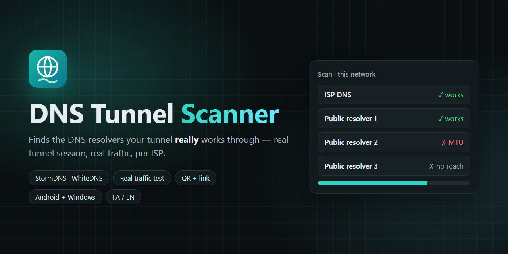

# DNS Tunnel Scanner

<a href="https://hits.sh/github.com/Plus98ir/DNS-Tunnel-Scanner/"></a> <a href="https://corenetbase.com/#support"></a>
<a href="https://github.com/Plus98ir/DNS-Tunnel-Scanner/releases/latest"></a>

<details>
<summary><b>☕ Support · حمایت</b> — USDT (TRC20) / TRX</summary>
<br>
<p align="center"></p>

```
TA53aFyGNfSAcrCaJi9QmA9x5W47nPJcf7
```

> [!WARNING]
> **TRON network only.** Sending from ERC20 / BEP20 will lose the funds.<br>
> **فقط شبکه‌ی TRON.** ارسال از ERC20 یا BEP20 پول را از بین می‌برد.

</details>

<div align="center">
<table><tr><td><a href="https://github.com/Plus98ir/DNS-Tunnel-Scanner/blob/main/README.md">🇺🇸 English</a></td><td><b>🇮🇷 فارسی</b></td></tr></table>
</div>

وب‌سایت: https://corenetbase.com/DNS-Tunnel-Scanner/



### Download · دانلود

| | Download | |
|---|---|---|
| **Android** | [DNS-Tunnel-Scanner.apk](https://github.com/Plus98ir/DNS-Tunnel-Scanner/releases/latest/download/DNS-Tunnel-Scanner.apk) | Android 7+ |
| **Windows** | [DNS-Tunnel-Scanner.exe](https://github.com/Plus98ir/DNS-Tunnel-Scanner/releases/latest/download/DNS-Tunnel-Scanner.exe) | double-click; no Python needed |

---

<div dir="rtl">

در قطعی اینترنت معمولاً فقط DNS کار می‌کند. تونل DNS ترافیک شما را داخل پرس‌وجوهای DNS، از طریق یک **ریزالور DNS**، به سرور تونل می‌برد. این‌که کدام ریزالورها آن را رد می‌کنند برای هر اپراتور فرق دارد و عوض می‌شود.

DNS Tunnel Scanner ریزالورها را روی همان اینترنتی که هستید تست می‌کند و فقط آن‌هایی را نگه می‌دارد که **واقعاً** کار می‌کنند:

۱. **فیلتر سریع**: یک نام تصادفی زیر دامنه‌ی تونل شما. فقط سرور تونل شما می‌تواند جوابش را بدهد؛ پس جواب یعنی ریزالور به سرور می‌رسد (هزاران ریزالور در دقیقه).

۲. **تست واقعی**: خود کلاینت StormDNS فقط با همان یک ریزالور اجرا می‌شود، اتصال تونل می‌سازد، یک صفحه‌ی HTTPS از داخلش باز می‌کند و سرعت را می‌سنجد. اگر اتصال نشد، یک بار دیگر امتحان می‌شود.

۳. **اشتراک**: ریزالورهای سالم، سریع‌ترین اول، به‌صورت متن، فایل یا QR، همراه لینک پروفایل WhiteDNS.

**استفاده**

۱. APK را نصب کنید (اندروید ۷ به بالا) یا EXE را اجرا کنید (ویندوز ۱۰/۱۱، پایتون لازم نیست).

۲. لینک پروفایل را یک بار بچسبانید (`stormdns://…` یا `masterdns://…`، مثلاً از WhiteDNS ← خروجی پروفایل). روی دستگاه خودتان می‌ماند؛ به پنل نیازی نیست.

۳. منبع‌ها را تیک‌خورده نگه دارید (DNS خود دستگاه، ریزالورهایی که قبلاً همین‌جا کار کرده‌اند، ریزالورهای عمومی ایرانی و خارجی)، اگر خواستید IP یا رنج CIDR خودتان را اضافه کنید و **شروع اسکن** را بزنید. چیزی کار نکرد؟ **اسکن عمیق** را روشن کنید: رنج آدرس‌های اپراتورتان را برای ریزالورهای بازی که در هیچ لیستی نیستند می‌گردد.

۴. در WhiteDNS: لینک پروفایل را وارد کنید و لیست ریزالورها را بچسبانید.

نتیجه به اپراتور بستگی دارد: روی هر سیم‌کارت / وای‌فای جدا اسکن کنید. برنامه ریزالورهای سالم را برای هر شبکه جدا یادش می‌ماند و دفعه‌ی بعد اول همان‌ها را تست می‌کند.

</div>

---

<div dir="rtl">

موتور تونل: [StormDNS](https://github.com/nullroute1970/StormDNS) (MIT)، از سورس ساخته شده.

</div>
