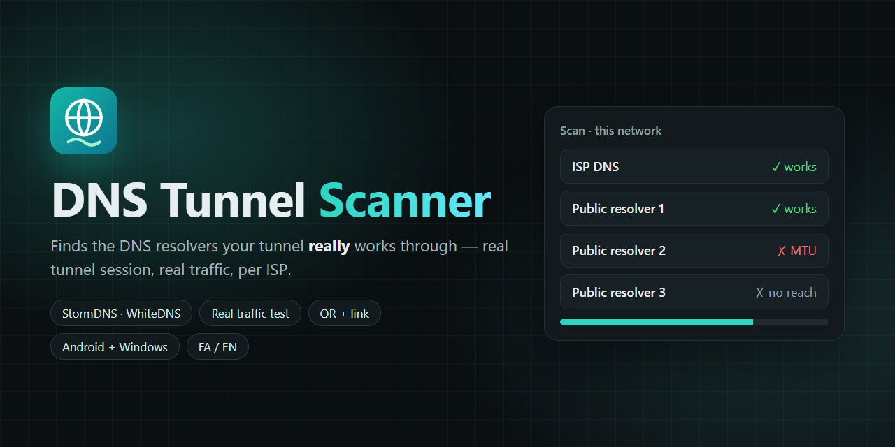

<h1 align="center">DNS Tunnel Scanner</h1>

<p align="center"><a href="https://hits.sh/github.com/Plus98ir/DNS-Tunnel-Scanner/"></a> <a href="https://corenetbase.com/#support"></a> <a href="https://github.com/Plus98ir/DNS-Tunnel-Scanner/releases/latest"></a></p>

<details>
<summary><b>☕ Support · حمایت</b> — USDT (TRC20) / TRX</summary>
<br>
<p align="center"></p>

```
TA53aFyGNfSAcrCaJi9QmA9x5W47nPJcf7
```

> [!WARNING]
> **TRON network only.** Sending from ERC20 / BEP20 will lose the funds.<br>
> **فقط شبکه‌ی TRON.** ارسال از ERC20 یا BEP20 پول را از بین می‌برد.

</details>

<details>
<summary><b>🇮🇷 فارسی</b></summary>

وب‌سایت: https://corenetbase.com/DNS-Tunnel-Scanner/



### Download · دانلود

| | Download | |
|---|---|---|
| **Android** | [DNS-Tunnel-Scanner.apk](https://github.com/Plus98ir/DNS-Tunnel-Scanner/releases/latest/download/DNS-Tunnel-Scanner.apk) | Android 7+ |
| **Windows** | [DNS-Tunnel-Scanner.exe](https://github.com/Plus98ir/DNS-Tunnel-Scanner/releases/latest/download/DNS-Tunnel-Scanner.exe) | double-click; no Python needed |

---

<div dir="rtl">

در قطعی اینترنت معمولاً فقط DNS کار می‌کند. تونل DNS ترافیک شما را داخل پرس‌وجوهای DNS، از طریق یک **ریزالور DNS**، به سرور تونل می‌برد. این‌که کدام ریزالورها آن را رد می‌کنند برای هر اپراتور فرق دارد و عوض می‌شود.

DNS Tunnel Scanner ریزالورها را روی همان اینترنتی که هستید تست می‌کند و فقط آن‌هایی را نگه می‌دارد که **واقعاً** کار می‌کنند:

۱. **فیلتر سریع**: یک نام تصادفی زیر دامنه‌ی تونل شما. فقط سرور تونل شما می‌تواند جوابش را بدهد؛ پس جواب یعنی ریزالور به سرور می‌رسد (هزاران ریزالور در دقیقه).

۲. **تست واقعی**: خود کلاینت StormDNS فقط با همان یک ریزالور اجرا می‌شود، اتصال تونل می‌سازد، یک صفحه‌ی HTTPS از داخلش باز می‌کند و سرعت را می‌سنجد. اگر اتصال نشد، یک بار دیگر امتحان می‌شود.

۳. **اشتراک**: ریزالورهای سالم، سریع‌ترین اول، به‌صورت متن، فایل یا QR، همراه لینک پروفایل WhiteDNS.

**استفاده**

۱. APK را نصب کنید (اندروید ۷ به بالا) یا EXE را اجرا کنید (ویندوز ۱۰/۱۱، پایتون لازم نیست).

۲. لینک پروفایل را یک بار بچسبانید (`stormdns://…` یا `masterdns://…`، مثلاً از WhiteDNS ← خروجی پروفایل). روی دستگاه خودتان می‌ماند؛ به پنل نیازی نیست.

۳. منبع‌ها را تیک‌خورده نگه دارید (DNS خود دستگاه، ریزالورهایی که قبلاً همین‌جا کار کرده‌اند، ریزالورهای عمومی ایرانی و خارجی)، اگر خواستید IP یا رنج CIDR خودتان را اضافه کنید و **شروع اسکن** را بزنید. چیزی کار نکرد؟ **اسکن عمیق** را روشن کنید: رنج آدرس‌های اپراتورتان را برای ریزالورهای بازی که در هیچ لیستی نیستند می‌گردد.

۴. در WhiteDNS: لینک پروفایل را وارد کنید و لیست ریزالورها را بچسبانید.

نتیجه به اپراتور بستگی دارد: روی هر سیم‌کارت / وای‌فای جدا اسکن کنید. برنامه ریزالورهای سالم را برای هر شبکه جدا یادش می‌ماند و دفعه‌ی بعد اول همان‌ها را تست می‌کند.

</div>

---

<div dir="rtl">

موتور تونل: [StormDNS](https://github.com/nullroute1970/StormDNS) (MIT)، از سورس ساخته شده.

</div>

</details>

<details open>
<summary><b>🇺🇸 English</b></summary>

Website: https://corenetbase.com/DNS-Tunnel-Scanner/


### Download · دانلود

| | Download | |
|---|---|---|
| **Android** | [DNS-Tunnel-Scanner.apk](https://github.com/Plus98ir/DNS-Tunnel-Scanner/releases/latest/download/DNS-Tunnel-Scanner.apk) | Android 7+ |
| **Windows** | [DNS-Tunnel-Scanner.exe](https://github.com/Plus98ir/DNS-Tunnel-Scanner/releases/latest/download/DNS-Tunnel-Scanner.exe) | double-click; no Python needed |

---

During an internet shutdown often only DNS still works. A DNS tunnel carries your traffic inside DNS queries, through a **DNS resolver**, to your tunnel server. Which resolvers carry it differs per ISP and changes over time.

DNS Tunnel Scanner tests them on your current network and keeps only the ones that **really** work:

1. **Quick filter**: a random name under your tunnel domain. Only your tunnel server can answer it, so an answer proves the resolver reaches the server (thousands of resolvers a minute).
2. **Real test**: the real StormDNS client starts with just that one resolver, builds a tunnel session and loads an HTTPS page through it, then measures the speed. A failed session gets a second try.
3. **Share**: the working resolvers, fastest first, as text, a file or a QR code, together with the WhiteDNS profile link.

**Use it**

1. Install the APK (Android 7+) or run the EXE (Windows 10/11, no Python needed).
2. Paste your profile link once (`stormdns://…` or `masterdns://…`, e.g. WhiteDNS → export profile). It stays on your device; no panel access is needed.
3. Keep the sources ticked (this device's DNS, resolvers that worked here before, Iranian and global public resolvers), add your own IPs or CIDR ranges if you like, and press **Start scan**. Nothing works? Turn on **Deep scan**: it searches your ISP's ranges for open resolvers no list has.
4. In WhiteDNS: import the profile link and paste the resolver list.

Results depend on the ISP: scan again on each SIM / Wi-Fi. The app remembers the working resolvers per network and tests them first next time.

---

Tunnel engine: [StormDNS](https://github.com/nullroute1970/StormDNS) (MIT), built from source.

</details>
